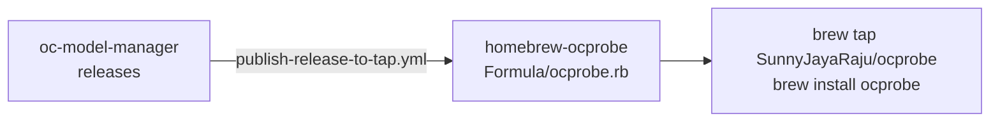

  

---

## 👋 Intro

I build secure, reliable systems: APIs, Automation & Developer Tooling. My work spans API gateways, command-line tools and the checks that keep releases safe. I work in public: the repositories below hold real code, tests and notes, including the experiments that did not go to plan.

---

## 🧰 Developer tooling & automation

| Project               | What it does                                                                      | Link                                                                 |
| --------------------- | --------------------------------------------------------------------------------- | -------------------------------------------------------------------- |
| oc-model-manager      | Bash CLI for the model-catalog lifecycle: diff, probe, safe apply and monitoring. | [Repository](https://github.com/SunnyJayaRaju/oc-model-manager)      |
| homebrew-ocprobe      | Homebrew tap for ocprobe, updated from the source releases.                       | [Repository](https://github.com/SunnyJayaRaju/homebrew-ocprobe)      |
| workstation-framework | Reproducible macOS developer workstation setup in Bash.                           | [Repository](https://github.com/SunnyJayaRaju/workstation-framework) |

The tap is generated from the source repository, so the Homebrew package follows each release.

---

## 🚀 API management

All implementations live inside the **[Apigee-Lab](https://github.com/SunnyJayaRaju/Apigee-Lab)** monorepo.

### 🛡️ Weather Shield Gateway (enterprise security layer)

A secure, optimized gateway for handling weather API traffic.

- Added **JWT authentication** and **Spike Arrest** to protect routes.
- Reduced backend load with **Response Caching** and smart pre-fetching.
- Implemented tiered **Monetization Quotas** (Silver/Gold) for controlled usage.

**Technologies:** `Apigee X` `JWT` `Caching Policies` `Spike Arrest` `FaultRules`

### 🏦 Secure Bank Access (OAuth 2.0 identity flows)

A mock banking API built to demonstrate clean identity and access management.

- Implemented **Client Credentials Flow** for machine-to-machine security.
- Designed **Conditional Proxy Flows** separating public and protected routes.
- Set up **Products, Developers, Apps** to enforce granular scopes and limits.

**Technologies:** `Apigee X` `OAuth 2.0` `Client Credentials` `Conditional Flows` `API Products`

### 🛒 Retail Mesh Orchestrator (microservices aggregation)

A composition layer for consolidating multiple backend responses into a single payload.

- Used parallel **Service Callouts** to reduce round-trips.
- Applied **JavaScript transformations** for JSON/XML normalization.
- Added fault-tolerant routing for stability during backend failures.

**Technologies:** `Apigee X` `JavaScript Policy` `Service Callout` `JSON Mashup` `API Composition`

### 🤖 Apigee DevOps Pipeline (full CI/CD automation)

A continuous delivery setup for API proxies.

- Built GitHub Actions workflows to lint, package and version proxies.
- Integrated `apigeelint` to catch structural and policy errors before merge.
- Added artifact staging for controlled deployments.

**Technologies:** `GitHub Actions` `Node.js` `Apigeelint` `Bash` `CI/CD`

### 🔐 Security Governance (Shared Flows)

A centralized security module for global policy enforcement.

- Built reusable **Shared Flows** to standardize logic across proxies.
- Enforced **Spike Arrests** and **Security Headers** globally via `FlowCallout`.
- Decoupled governance rules from individual proxy logic.

**Technologies:** `Apigee X` `Shared Flows` `FlowCallout` `Traffic Management`

---

## 📚 Knowledge base

### 📘 [Curious-Explorer](https://github.com/SunnyJayaRaju/Curious-Explorer)

A structured technical notebook: concepts (OAuth, JWT, reverse proxies, governance), a bug log of real debugging notes, and reusable policy snippets.

### 🌐 [Live portfolio](https://sunnyjayaraju.github.io)

Semantic HTML and CSS, deployed with GitHub Pages.

---

## 🔎 Exploring

- **AI quality & evaluation** — probing and comparing model catalogues in a repeatable way through `oc-model-manager`. The tooling exists; the evaluation methods are still taking shape.
- **Security & reliability** — secret scanning, pinned dependencies and release checks that fail loudly. Used in the repos above, not a finished discipline.

---

## 🛠 Skills & tools

**Apigee | OAuth2 | JWT | CI/CD | GitHub Actions | Postman | Linux | JavaScript**

  
  
  
  
  
  

---

## 🎯 What's next

1. Standardizing security logic through **Shared Flows**.
2. Exploring **advanced traffic management** and priority-based rate limiting.
3. Designing **Developer Portals** for API consumer onboarding.

---

## 📬 Connect

 - 

---

  <i>I learn in public because it keeps me curious and accountable. Every commit, even the messy ones, moves the needle.</i>

